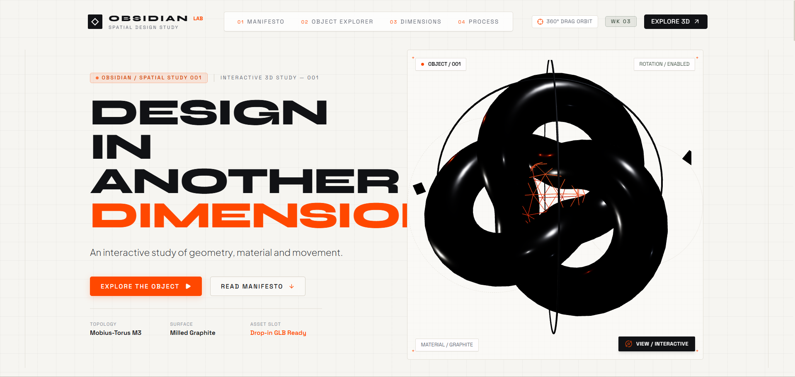
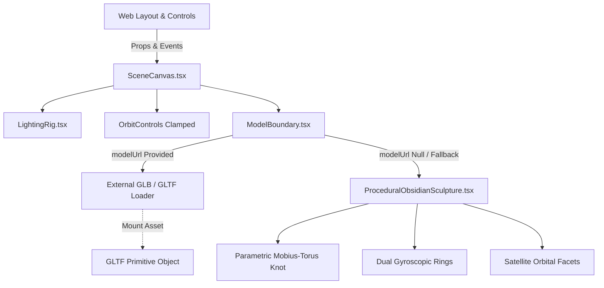

<div align="center">

```
  ██████╗ ██████╗ ███████╗██╗██████╗ ██╗ █████╗ ███╗   ██╗
 ██╔═══██╗██╔══██╗██╔════╝██║██╔══██╗██║██╔══██╗████╗  ██║
 ██║   ██║██████╔╝███████╗██║██║  ██║██║███████║██╔██╗ ██║
 ██║   ██║██╔══██╗╚════██║██║██║  ██║██║██╔══██║██║╚██╗██║
 ╚██████╔╝██████╔╝███████║██║██████╔╝██║██║  ██║██║ ╚████║
  ╚═════╝ ╚═════╝ ╚══════╝╚═╝╚═════╝ ╚═╝╚═╝  ╚═╝╚═╝  ╚═══╝
```

### ◈ SPATIAL DESIGN LABORATORY ◈
**Form in Another Dimension · Algoryx UI/UX Design Internship — Week 3**

[](https://react.dev/)
[](https://threejs.org/)
[](https://vitejs.dev/)
[](https://www.typescriptlang.org/)
[](https://tailwindcss.com/)
[](https://algoryx.com/)

<p align="center">
  <a href="#-project-overview">Overview</a> •
  <a href="#-key-features">Features</a> •
  <a href="#-3d-scene-architecture">3D Pipeline</a> •
  <a href="#-page-composition">Page Structure</a> •
  <a href="#-interactive-matrix">Controls Matrix</a> •
  <a href="#-quick-start">Quick Start</a> •
  <a href="#-asset-transparency">Asset Boundary</a>
</p>

---

</div>

<br />

<div align="center">
  
</div>

<br />

## ◈ Project Overview

> [!NOTE]
> **OBSIDIAN** is an experimental **interactive spatial design laboratory**: a digital environment where mathematical topology, mineral materials, kinematics, and spatial interaction are examined with architectural and industrial design discipline.

Rather than relying on dark futuristic clichés, OBSIDIAN introduces a **predominantly light architectural canvas** (`#f6f5f1`) accented by precision graphite structural framing and electric vermilion (`#ff4800`) focal points. The 3D geometry serves as the central character of the experience, directly driving the typographic hierarchy, measurement lines, and spatial interaction.

---

## ◈ Key Features

<table>
  <tr>
    <td width="50%">
      <h3>🏛️ Architectural Canvas</h3>
      <p>Warm mineral stone and bone background with subtle hairline measurement grids, corner crosshair markers (<code>+</code>), and coordinate tracking annotations.</p>
    </td>
    <td width="50%">
      <h3>🔮 Parametric 3D Core</h3>
      <p>Continuous tangent curvature (<code>G2 continuity</code>) Mobius-Torus knot with counter-rotating gyroscopic rings and floating satellite shards.</p>
    </td>
  </tr>
  <tr>
    <td width="50%">
      <h3>🎛️ Interactive Object Deck</h3>
      <p>Dynamic <b>FORM / MATERIAL / MOTION</b> tabs that directly adjust Cook-Torrance PBR shaders, exploded topologies, and kinematic momentum.</p>
    </td>
    <td width="50%">
      <h3>⚡ Calibrated Kinematics</h3>
      <p>Rotational inertia calibrated to cursor velocity with a <code>0.045 s⁻¹</code> damping glide. Wheel zoom isolated to prevent scroll hijacking.</p>
    </td>
  </tr>
  <tr>
    <td width="50%">
      <h3>🔌 Drop-in Asset Boundary</h3>
      <p>Decoupled asset loading layer allowing official Algoryx Community <code>.glb</code>/<code>.gltf</code> models to replace the procedural sculpture seamlessly.</p>
    </td>
    <td width="50%">
      <h3>📱 Responsive & Performant</h3>
      <p>Adaptive device pixel ratio (<code>dpr=[1, 1.25]</code> mobile / <code>[1, 1.75]</code> desktop), touch gesture support, and WebGL hardware fallback.</p>
    </td>
  </tr>
</table>

---

## ◈ 3D Scene Architecture & Decoupled Pipeline

The 3D subsystem is engineered with a strict isolation boundary between user interface state and WebGL rendering:



> [!TIP]
> **Zero Layout Coupling:** The page layout, lighting rig, and orbit controls do not depend on the mesh topology. Once an official Algoryx asset is dropped in, the website adopts it with zero refactoring.

---

## ◈ Interactive Information Matrix

The **Object Explorer** features a dedicated three-axis control panel where selecting a tab updates both explanatory technical copy and visual 3D attributes:

| Axis Tab | Explanatory Focus | Interactive Modifiers | 3D Scene Visual Response |
| :--- | :--- | :--- | :--- |
| **`FORM`** | Topological silhouette & $G^2$ continuous curvature | `Exploded View` / `CAD Wireframe` | Gyroscopic rings expand outward by 1.6×; geometry converts to orange CAD wireframe lines. |
| **`MATERIAL`** | Cook-Torrance PBR microfacets & mineral absorption | `Graphite` / `Ceramic` / `Titanium` / `Vermilion` | Dynamically swaps surface roughness, clearcoat reflectance, metalness, and substrate tint. |
| **`MOTION`** | Momentum dissipation & drag velocity coupling | `Axial Inertia` / `Harmonic Kinetic` / `Static Lock` | Switches between cursor-coupled rotation, sinusoidal oscillation, or coordinate-locked freeze. |

---

## ◈ Page Structure & Editorial Flow

```
OBSIDIAN Experience
├── 01 // HERO           → "DESIGN IN ANOTHER DIMENSION." + Live 3D Centerpiece
├── 02 // MANIFESTO       → "SHAPE IS A DECISION." + Spatial Fabrication Axioms
├── 03 // OBJECT EXPLORER → Primary 3D Workspace + FORM / MATERIAL / MOTION Deck
├── 04 // DIMENSIONS      → Three connected chapters: 01 FORM, 02 MATERIAL, 03 MOTION
├── 05 // PROCESS         → Four-stage workflow: OBSERVE → SHAPE → INTERACT → REFINE
├── 06 // CONCLUSION      → "THERE IS MORE TO EXPLORE." + Return to Explorer Action
└── 07 // FOOTER          → Architecture Baseline, Technical Specs & Attribution
```

---

## ◈ Asset Transparency & Drop-in Replacement

> [!IMPORTANT]
> **Current Asset Status:** In accordance with the Week 3 guidelines, an official 3D asset from the Algoryx Community has not yet been received. The experience currently runs an **original procedural Three.js sculpture** (`ProceduralObsidianSculpture.tsx`) and is honestly documented as a prototype in the UI.

### Replacing with an Official Algoryx Asset:
1. Place your `.glb` or `.gltf` model inside:
   ```
   public/models/algoryx-asset.glb
   ```
2. Pass the `modelUrl` prop in `HeroSection.tsx` and `ObjectStudySection.tsx`:
   ```tsx
   <SceneCanvas modelUrl="/models/algoryx-asset.glb" />
   ```
3. `ModelBoundary.tsx` will automatically mount the model inside the existing camera perspective and lighting rig without modifying any page layouts.

---

## ◈ Quick Start & Installation

### Prerequisites
- Node.js (v18.0.0 or higher)
- npm / pnpm / yarn

### Local Setup
```bash
# 1. Clone the repository
git clone https://github.com/aeternum-core/algoryx-week3-obsidian.git

# 2. Enter project directory
cd algoryx-week3-obsidian

# 3. Install dependencies
npm install

# 4. Start local development server
npm run dev
```

Visit [`http://localhost:5173/`](http://localhost:5173/) to explore the live experience.

### Production Build
```bash
# Compile TypeScript and generate production bundle
npm run build
```
*Build verified: compiled in < 1.0s with 0 errors (`tsc -b && vite build`).*

---

## ◈ Project Attribution

<div align="center">

| Student / Creator | Internship Program | Project Week | Repository |
| :---: | :---: | :---: | :---: |
| **Likith V Gowda** | **Algoryx UI/UX Design Internship** | **Week 03** | [algoryx-week3-obsidian](https://github.com/aeternum-core/algoryx-week3-obsidian) |

<br />

```
OBSIDIAN // SPATIAL DESIGN LABORATORY © 2026
Form in Another Dimension · Released under MIT License
```

</div>
